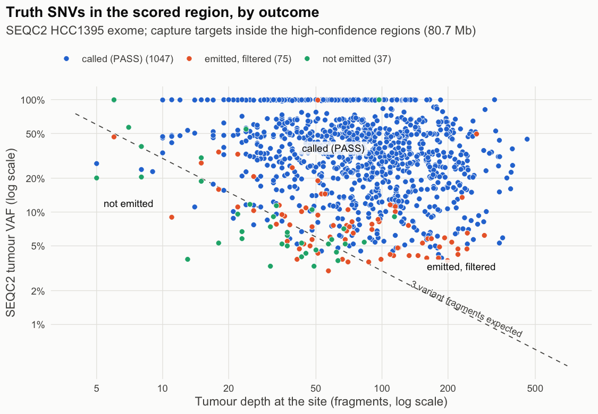
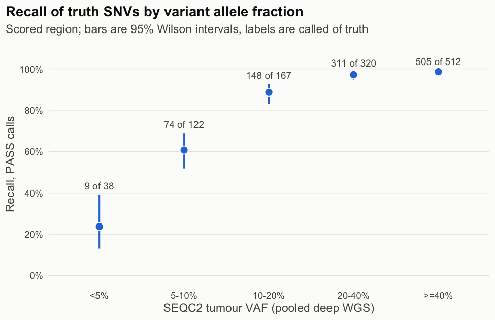

### Somatic accuracy: SEQC2 HCC1395 exome

On the SEQC2 HCC1395 tumour/normal exome, the somatic pipeline's PASS calls reach 99.1%
precision and 90.3% recall for single-nucleotide variants (SNVs), and 78.8% precision and
85.4% recall for small insertions and deletions (indels). These scores are against the SEQC2
somatic reference call set, inside the capture targets that lie in its high-confidence regions
(80.7 Mb). Recall depends mostly on the variant allele fraction (VAF): the pipeline calls
98.6% of true SNVs at a VAF of 40% or more, and 23.7% of those below 5%. Two thirds of the
missed SNVs were emitted by Mutect2 and then removed by FilterMutectCalls, most of them by its
contamination filter.

| Variant | Truth | PASS calls | True positives | Precision (95% interval) | Recall (95% interval) | F1 |
|---|---|---|---|---|---|---|
| SNV | 1,159 | 1,056 | 1,047 | 0.991 (0.984 to 0.996) | 0.903 (0.885 to 0.919) | 0.945 |
| Indel | 48 | 52 | 41 | 0.788 (0.660 to 0.878) | 0.854 (0.728 to 0.928) | 0.820 |

#### Data and run

The tumour is HCC1395, a breast cancer cell line, and the normal is HCC1395BL, a B-lymphoblastoid
line from the same donor ([Fang et al. 2021](https://doi.org/10.1038/s41587-021-00993-6)).
The data are SEQC2's Illumina-centre exome libraries (`WES_IL_T_1` and `WES_IL_N_1`;
Agilent SureSelect V6 + UTR capture), as the BWA-MEM alignments SEQC2 publishes. Median tumour
depth at the scored truth sites is 76 fragments (10th to 90th percentile 29 to 185).

The run is `call_bam_GATK` at commit `a95c554` (GATK 4.6.2), with the config in
`benchmark/seqc2/config_seqc2.yaml`: base quality score recalibration (BQSR), then Mutect2
tumour vs normal over the targets padded by 100 bp with gnomAD as the germline resource, a
contamination estimate from CalculateContamination, the read-orientation model, and
FilterMutectCalls. No panel of normals was used.

The truth is the SEQC2 somatic reference call set v1.2.1: 39,447 SNVs and 1,625 indels graded
HighConf or MedConf, inside 2,485 Mb of high-confidence regions.

#### Scoring

`benchmark/seqc2/evaluate_seqc2.R` follows the SEQC2 exome benchmark
([Xiao et al. 2021](https://doi.org/10.1038/s41587-021-00994-5)): calls and truth are restricted
to the capture targets, recall is TP/(TP+FN) and precision TP/(TP+FP) (true positives, false
negatives, false positives), and F1 is the harmonic mean of the two. Details the SEQC2 papers do
not state in their main text are fixed here:

- Scored region: capture targets (primary chromosomes) intersected with the high-confidence
  regions, 80.7 Mb of the 90.5 Mb of targets. The padded calling region intersected with the
  high-confidence regions (119.1 Mb) is reported as a secondary check.
- Normalisation: both sides go through the same `bcftools norm` steps (multiallelic records
  split, indels left-aligned against the reference, and Mutect2's multi-base substitutions
  split into single SNVs). Mutect2 writes adjacent substitutions carried by the same reads as one
  record, while the truth set lists each SNV separately.
- Matching: exact on chromosome, position, REF and ALT. A record is in a region when its POS is.
  An unmatched indel call within 10 bp of an unmatched truth indel would point to a
  representation difference; there are none.
- Intervals: 95% Wilson score intervals.
- Check: `bcftools isec` on the same normalised records reproduces every TP, FP and FN count.

Read counts at truth sites come from the recalibrated BAMs with Mutect2's default read filters
(mapping quality 20 or more, base quality 10 or more, duplicates removed). They are counted per
DNA fragment (the two reads of an overlapping pair count once), as Mutect2 weighs evidence by
default (mates are not independent evidence), so they run lower than Mutect2's own `DP` (median
78 against 104 at the called truth SNVs). The observed tumour VAF tracks SEQC2's VAF from pooled
deep whole-genome sequencing (r = 0.987 at the 1,111 truth SNVs with 20 or more fragments).

#### Precision and recall

| Region | Variant | Truth | Calls | TP | FP | FN | Precision | Recall | F1 |
|---|---|---|---|---|---|---|---|---|---|
| Targets in high-confidence regions (80.7 Mb) | SNV | 1,159 | 1,056 | 1,047 | 9 | 112 | 0.991 | 0.903 | 0.945 |
| | Indel | 48 | 52 | 41 | 11 | 7 | 0.788 | 0.854 | 0.820 |
| Padded targets in high-confidence regions (119.1 Mb) | SNV | 1,666 | 1,427 | 1,402 | 25 | 264 | 0.982 | 0.842 | 0.907 |
| | Indel | 72 | 67 | 54 | 13 | 18 | 0.806 | 0.750 | 0.777 |

Recall falls in the 100 bp padding (355 of the 507 truth SNVs found there, 70%) because capture
coverage thins away from the probes.

#### Missed SNVs



*Figure 1. Each of the 1,159 truth SNVs in the scored region, by tumour depth and SEQC2 VAF. The
dashed line marks where three variant fragments are expected. Called SNVs (blue) dominate above
10% VAF; SNVs removed by FilterMutectCalls (orange) form a band at 4 to 10% VAF at every depth;
SNVs never emitted (green) sit near or below the line.*



*Figure 2. Recall by SEQC2 VAF, with 95% Wilson intervals: 24% below 5% VAF, 61% at 5 to 10%,
89% at 10 to 20%, 97% at 20 to 40% and 99% at 40% or more.*

The missed SNVs are low-VAF variants (median SEQC2 VAF 6.9%, against 37.3% for the called ones),
and most of them reached FilterMutectCalls:

| Why a truth SNV was missed | SNVs |
|---|---|
| Removed by the contamination filter (alone or with other filters) | 57 |
| Removed for strand bias (alone or with weak evidence) | 9 |
| Removed by the read-orientation filter | 5 |
| Removed as clustered events | 3 |
| Removed for weak evidence alone | 1 |
| Never emitted, no variant fragments in the tumour | 9 |
| Never emitted, 1 or 2 variant fragments | 22 |
| Never emitted, 3 or more variant fragments | 6 |
| Total | 112 |

Read evidence tells the same story. The pipeline calls 98.8% of truth SNVs with 10 or more variant
fragments (903 of 914), 80.7% with 5 to 9, 40.0% with 3 or 4, 17.1% with 1 or 2, and none of the 9
with no variant fragment at all. Depth matters less: recall is 70.8% below 20 fragments and 92 to
94% from 50 to 199.

The contamination filter is the largest single cause. CalculateContamination put the tumour's
contamination (DNA from another person) at 4.0% and the normal's at 0.03%. FilterMutectCalls
then treats a variant whose fraction sits near the contamination level as possibly coming from
the contaminant, and the 57 true SNVs it removed have SEQC2 VAFs of 3.8 to 10.4% (10th to 90th
percentile; median 5.8%); 51 of them are absent from gnomAD.

#### Filter settings tested

`benchmark/seqc2/backtest_filters.sh` re-filters the same Mutect2 calls two other ways and scores
each (about 90 seconds in all):

| FilterMutectCalls setting | SNV calls | SNV TP | SNV FP | SNV F1 | Indel TP | Indel FP | Indel F1 |
|---|---|---|---|---|---|---|---|
| As run (contamination table, orientation priors) | 1,056 | 1,047 | 9 | 0.945 | 41 | 11 | 0.820 |
| Adding `--tumor-segmentation` | 1,021 | 1,015 | 6 | 0.931 | 40 | 10 | 0.816 |
| Without the contamination table | 1,115 | 1,081 | 34 | 0.951 | 42 | 16 | 0.792 |

GATK's published Mutect2 workflow passes the tumour segmentation from CalculateContamination to
FilterMutectCalls ([mutect2.wdl](https://github.com/broadinstitute/gatk/blob/master/scripts/mutect2_wdl/mutect2.wdl)),
and this pipeline does not. On this tumour, adding it costs 32 true SNVs to remove 3 false ones,
so the pipeline stays as it is.

Dropping the contamination table recovers 34 true SNVs but admits 25 more false SNVs and 5 more
false indels; SNV F1 rises from 0.945 to 0.951 and indel F1 falls from 0.820 to 0.792. The 31
false-positive records that appear only without the table have a median tumour VAF of 4.2%, close
to the contamination estimate, but only 2 lie at sites with a gnomAD allele frequency of 1% or
more (21 are absent from gnomAD). A contaminating genome would show up as its germline variants,
most of them common, so these look like low-fraction artefacts rather than contamination. This
data cannot say whether the 4.0% estimate is real; what it shows is that the filter here removes
about as much noise as signal at 4 to 10% VAF. The pipeline keeps the contamination filter, since
on a sample that really is contaminated it is the only safeguard against calling the
contaminant's variants.

#### False positives

The 20 PASS false positives in the scored region are 9 SNVs and 11 indel records (8 indel events:
three complex events are each written as two records). None is in SEQC2's superset (its
all-inclusive call set, graded HighConf, MedConf, LowConf or Unclassified).

The SNVs have thin support: 2 to 5 supporting reads and tumour log odds (TLOD) of 5.7 to 12.2.
Three of the nine are C>A (G>T) changes, against 13% of true SNVs; SEQC2 saw excess G>T
changes in some exome libraries of these cell lines, probably from oxidative DNA damage (Xiao et
al. 2021), but nine calls are too few to attribute.

Several indel false positives have strong support. The complex event at chr16:19,551,340 has 129
supporting reads at a depth of 526 to 635, with none in the normal; the pairs at chr2:197,500,318
and chr20:17,693,692 have 35 and 14. Whether these are real events that no SEQC2 pipeline
reported or errors in hard sequence cannot be settled from this data.

#### Keep rule for the annotated tables

The annotated tumour-vs-normal tables keep calls whose FILTER is exactly PASS or
`normal_artifact` (`filter_GATK: ['PASS', 'normal_artifact']`, the default in the three somatic
configs), with a VAF of 0.02 or more (`filter_min_af`) and a depth of 5 or more (`filter_min_dp`).
Scored the same way (without the Combined Annotation Dependent Depletion (CADD) cut, which ranks
functional impact rather than calling), the `normal_artifact` calls add 18
records to the scored region (14 SNVs and 4 indels) and no true positive. Each has 1 to 80
supporting reads in the normal, and none is in the SEQC2 superset. SNV precision falls from 0.991
to 0.979 and indel precision from 0.788 to 0.732.

The SEQC2 normal is a separate cell line with no tumour cells in it, so this pair cannot test
whether the rule rescues real somatic variants that also show up in a normal sample (for example,
tumour cells in an adjacent-normal biopsy). With a clean matched normal, `filter_GATK: ['PASS']`
is the better setting.

#### Calls outside the scored region

The truth set can score 1,108 of the 3,648 PASS records. Another 386 lie in the padding inside
the high-confidence regions (scored in the padded check), 493 in the padding outside them, and
1,661 in capture targets outside the high-confidence regions. Those 1,661 are dense: 169 per Mb,
against 13.7 per Mb in the scored region.

They are not caller noise. The high-confidence regions contain no chrX and leave out chr6 from
0.4 to 56.6 Mb and chr16 from 46.6 to 89.9 Mb, and 1,602 of the 1,661 calls are there. Most are
common germline polymorphisms (gnomAD allele frequency of 1% or more: 724 of 817 on chr6, 390 of
446 on chr16, 274 of 339 on chrX) with high tumour VAF, and the normal has no supporting read at
95 to 97% of them. That is the pattern expected where the normal line carries only one parental
copy (loss of heterozygosity in HCC1395BL): inherited variants on the other copy are present in
the tumour and absent from the normal, so they look somatic. SEQC2's own callers made the same
calls and graded most of them HighConf in the superset. It is a property of this reference pair,
and it is why these regions cannot be scored.

#### Limitations

- One library pair from one sequencing centre. SEQC2 published exome replicates from several
  centres; only this one was run.
- The scored region is 89% of the capture targets; chrX and the stretches of chr6 and chr16 above
  are not scored.
- With 48 truth indels, the indel intervals are wide (precision 0.660 to 0.878).
- The run used no panel of normals. GATK's workflow lists one as optional but usually recommended;
  its effect on the false positives here is untested.
- SEQC2's VAFs come from pooled deep whole-genome sequencing of other libraries, not from this
  exome.

#### Reproducing the benchmark

Download the data (about 27 GB; the script checks the BAMs against SEQC2's md5 sums) and the
references (`scripts/download_references.sh`, see [requirements](requirements.md)):

```
benchmark/seqc2/download_seqc2.sh /data/seqc2
```

Fill in the config and sample sheet, then run the somatic pipeline to the tumour-vs-normal
calls (on a 10-core M1 Max, BQSR takes about 55 minutes per sample; the full calling stage, which
also calls each sample against the reference, took 78 minutes):

```
sed -e 's|<SEQC2_DIR>|/data/seqc2|' -e 's|<REFERENCE_DIR>|/data/references|' \
    -e 's|<OUTPUT_DIR>|/data/seqc2_run|' benchmark/seqc2/config_seqc2.yaml > config_seqc2.yaml
sed 's|<SEQC2_DIR>|/data/seqc2|' benchmark/seqc2/bam_metadata.tsv > /data/seqc2/bam_metadata.tsv
snakemake -s call_bam_GATK/call_bam_GATK.snakefile --configfile config_seqc2.yaml --cores 10 \
    /data/seqc2_run/03_variants_TvN/01_gatk_variant_calling/filtered/HCC1395_Dx_filtered.vcf
```

Score it (about 20 seconds), and optionally backtest the filter settings, in the pipeline
environment:

```
REF=/data/references/Homo_sapiens_assembly38.fasta
Rscript benchmark/seqc2/evaluate_seqc2.R /data/seqc2_run $REF /data/seqc2 seqc2_results
benchmark/seqc2/backtest_filters.sh /data/seqc2_run $REF /data/seqc2 seqc2_backtest
```

A rerun can differ by a call or two at sites where more than 50 reads start at the same position
(GATK downsamples those with a random sequence; see [Performance](somatic.md#performance)). The
results of the run described here are in `benchmark/seqc2/results/` and printed at the end of
each step in the two scripts.

#### References

- Fang LT et al. (2021). Establishing community reference samples, data and call sets for
  benchmarking cancer mutation detection using whole-genome sequencing. *Nature Biotechnology*
  39:1151. https://doi.org/10.1038/s41587-021-00993-6
- Xiao W et al. (2021). Toward best practice in cancer mutation detection with whole-genome and
  whole-exome sequencing. *Nature Biotechnology* 39:1141.
  https://doi.org/10.1038/s41587-021-00994-5
- Broad Institute. Mutect2 workflow, `scripts/mutect2_wdl/mutect2.wdl` in the GATK repository.
  https://github.com/broadinstitute/gatk/blob/master/scripts/mutect2_wdl/mutect2.wdl
